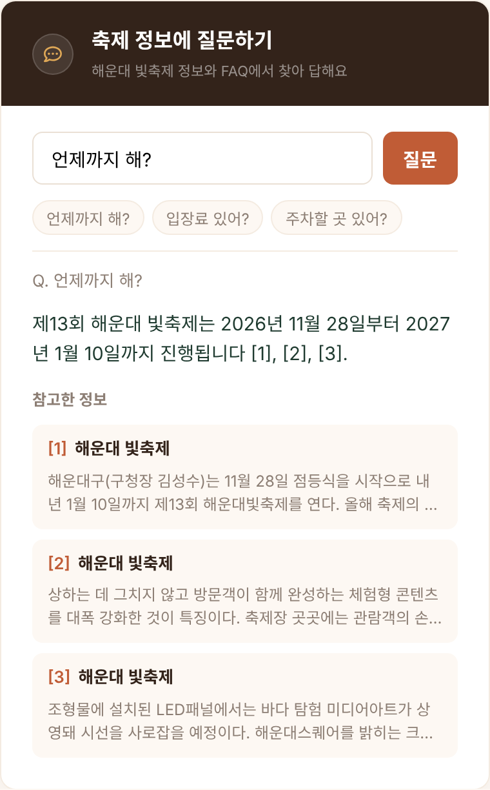
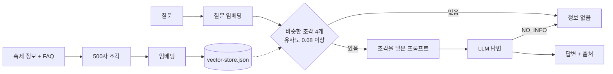

# 🎡 축제 정보 & 편의 서비스 플랫폼

## 📌 프로젝트 소개

가족 단위 방문객이 축제 정보 외에도 유모차 대여, 주차 가능 여부 등 편의 정보를 따로 찾아야 하는 불편함을, TourAPI 데이터와 AI 요약을 결합해 해결합니다.

TourAPI를 통해 제공되는 실시간 축제 정보에 더해, OpenAI가 생성하는 AI 요약을 결합하여 사용자 편의성을 높였습니다. 사용자는 축제를 검색하고 상세 정보를 확인하며, '찜하기' 기능을 통해 자신만의 축제 목록을 관리할 수 있습니다.

---

## 🛠 기술 스택

### **Backend**

### **Frontend**

### **External API**

### **Collaboration**

---

## ✨ 주요 기능

* **축제 정보 통합 조회:** TourAPI 연동을 통한 전국 축제 및 행사 정보 제공
* **AI 요약 서비스:** OpenAI API를 활용한 축제 핵심 정보 요약 (가족 단위 편의시설 중심)
* **상세 정보 및 편의 시설 안내:** 유모차 대여, 주차장 유무 등 맞춤형 정보 제공
* **찜하기 기능:** 관심 있는 축제를 북마크하여 마이페이지에서 관리
* **축제 정보 질문하기 (RAG):** 저장된 축제 정보와 FAQ에서 근거를 찾아 답하고, 참고한 문서를 함께 보여 줌

---

## 💬 RAG 질문 답변

`POST /api/rag/ask`로 질문하면 저장된 축제 정보와 FAQ에서 비슷한 조각을 찾아, LLM이 그 조각만 보고 답합니다. 참고한 조각은 `sources`로 함께 돌려주고, 근거가 없으면 정보가 없다고 답합니다.

**이렇게 고른 이유**
- **저장소:** MariaDB라 pgvector를 쓸 수 없고, 축제 수백 건은 메모리에서 비교해도 충분해서 Spring AI `SimpleVectorStore`(JSON 파일 저장)를 썼습니다. `VectorStore` 인터페이스로 호출하므로 나중에 저장소만 바꾸면 됩니다.
- **모델:** 기존 OpenAI 설정에서 주소만 바꿔 Gemini를 씁니다. 임베딩은 `gemini-embedding-001`, 답변은 `gemini-3.1-flash-lite`입니다.
- **`aiInfo` 제외:** LLM이 추측을 섞어 만든 꿀팁이라 근거 문서에서 뺐습니다.

**정보 없음 판단:** 유사도 0.68 미만 조각은 버리고, 남은 조각이 없으면 LLM을 부르지 않습니다. 조각이 있어도 LLM이 `NO_INFO`라고 답하면 정보 없음으로 돌려줍니다.

**평가:** TourAPI 축제 59개와 FAQ로 만든 질문 23개에서 23개 정답입니다. 답이 있는 질문 15개, 축제는 맞지만 답이 없는 질문 4개, 상관없는 질문 4개로 나눴고, 기준값 0.50~0.80을 비교해 0.68을 골랐습니다. `./gradlew evalRag`로 다시 잴 수 있습니다.

**API** (`.env`에 `OPEN_AI_KEY`=Gemini 키, `SERVICE_KEY`=TourAPI 키)

| API | 하는 일 | 로그인 |
| --- | --- | --- |
| `POST /api/rag/festivals/sync` | TourAPI에서 축제를 받아 DB에 저장 | 필요 |
| `POST /api/rag/index` | 축제와 FAQ를 조각내 임베딩 저장 | 필요 |
| `POST /api/rag/ask` | 질문에 답하고 출처를 함께 돌려줌 | 불필요 |
