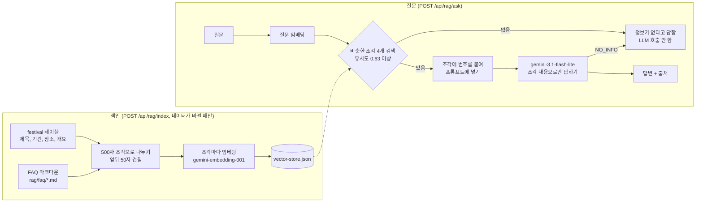

# 🎡 축제 정보 & 편의 서비스 플랫폼

## 📌 프로젝트 소개

가족 단위 방문객이 축제 정보 외에도 유모차 대여, 주차 가능 여부 등 편의 정보를 따로 찾아야 하는 불편함을, TourAPI 데이터와 AI 요약을 결합해 해결합니다.

TourAPI를 통해 제공되는 실시간 축제 정보에 더해, OpenAI가 생성하는 AI 요약을 결합하여 사용자 편의성을 높였습니다. 사용자는 축제를 검색하고 상세 정보를 확인하며, '찜하기' 기능을 통해 자신만의 축제 목록을 관리할 수 있습니다.

---

## 🛠 기술 스택

### **Backend**


### **Frontend**


### **External API**


### **Collaboration**


---

## ✨ 주요 기능

* **축제 정보 통합 조회:** TourAPI 연동을 통한 전국 축제 및 행사 정보 제공
* **AI 요약 서비스:** OpenAI API를 활용한 축제 핵심 정보 요약 (가족 단위 편의시설 중심)
* **상세 정보 및 편의 시설 안내:** 유모차 대여, 주차장 유무 등 맞춤형 정보 제공
* **찜하기 기능:** 관심 있는 축제를 북마크하여 마이페이지에서 관리
* **축제 정보 질문하기 (RAG):** 저장된 축제 정보와 FAQ에서 근거를 찾아 답하고, 참고한 문서를 함께 보여 줌

---

## 💬 RAG 질문 답변

`POST /api/rag/ask`로 질문을 보내면 서비스에 저장된 축제 정보와 FAQ에서 관련 조각을 찾고, LLM이 그 조각만 보고 답합니다. 답마다 참고한 조각을 `sources`로 돌려주고, 관련 조각이 없으면 지어내지 않고 정보가 없다고 답합니다.

### 전체 흐름



### 저장소와 임베딩을 이렇게 고른 이유

**저장소는 Spring AI `SimpleVectorStore`(메모리 + JSON 파일)를 썼습니다.** 이 프로젝트 DB는 MariaDB라 pgvector를 쓸 수 없습니다. 축제 데이터는 상세 페이지를 연 축제만 쌓여서 많아야 수백 건이고, 이 정도는 메모리에서 전부 비교해도 금방 끝납니다. 서버를 따로 띄울 필요가 없어서 하루 안에 붙일 수 있었습니다. 검색 코드는 `VectorStore` 인터페이스로만 호출하므로, 데이터가 늘면 저장소 빈만 pgvector나 MariaDB 11.7의 VECTOR 타입으로 바꾸면 됩니다.

**임베딩과 답변은 Gemini를 OpenAI 호환 주소로 호출합니다.** 이미 쓰던 `spring-ai-starter-model-openai` 설정에서 `base-url`과 모델 이름만 바꿨기 때문에 의존성을 새로 넣지 않았고, 기존 AI 꿀팁 기능도 같은 키로 동작합니다. `gemini-embedding-001`은 한국어 문장도 뜻이 비슷하면 가깝게 묶어 줘서, "유모차 끌고 가도 돼?"로 "유모차 대여소 운영" 조각을 찾을 수 있습니다.

**`aiInfo` 컬럼은 근거 문서에서 뺐습니다.** 이 값은 LLM이 "개요에 없어도 상식적인 안내를 넣어라"라는 프롬프트로 만든 글입니다. 근거로 쓰면 모델이 추측한 내용을 다시 사실처럼 답하게 됩니다.

### "정보가 없다"를 판단하는 두 단계

1. 검색 단계에서 유사도가 `rag.similarity-threshold`(기본 0.63)보다 낮은 조각은 버립니다. 남는 조각이 없으면 LLM을 부르지 않습니다.
2. 조각이 남아도 질문에 답할 내용이 없을 수 있습니다. 그래서 프롬프트에 "답할 수 없으면 NO_INFO만 출력하라"고 적고, 이 응답이 오면 정보 없음으로 바꿔 돌려줍니다.

### 기준값 0.63을 정한 과정

처음에는 0.65로 잡았다가, 테스트용 축제 6개와 FAQ 5개로 색인을 만들고 질문 12개를 직접 던져 점수를 쟀습니다. 아래는 질문마다 1순위 조각의 유사도입니다.

| 질문 종류 | 개수 | 1순위 유사도 | 원하는 결과 |
| --- | --- | --- | --- |
| 문서에 답이 있음 ("한빛 머드축제 체험 입장료 얼마야?") | 7 | 0.707 ~ 0.842 | 답변 |
| 축제는 맞지만 문서에 답이 없음 ("머드축제에 샤워장 있어?") | 2 | 0.678 ~ 0.702 | 정보 없음 |
| 서비스와 상관없음 ("오늘 달러 환율 얼마야?") | 3 | 0.635 이하 | 정보 없음 |

0.65로 두면 "제주도 감귤 따기 체험 언제 해?"(0.635)는 막지만, 답이 있는 질문과 거리가 0.05밖에 안 났습니다. 그래서 상관없는 질문 대부분을 검색에서 거르고, 애매한 건 LLM 단계에서 거르도록 0.63으로 내렸습니다. 이 값으로 12개 모두 원하는 결과가 나왔습니다. 감귤 질문은 0.635로 검색을 통과했지만 LLM이 NO_INFO를 냈습니다.

같은 질문으로 `gemini-embedding-2`도 비교했는데, "찜하기는 어떻게 해?"가 0.578로 상관없는 질문과 구분되지 않아 `gemini-embedding-001`을 그대로 썼습니다.

테스트 데이터가 6건이라 실제 TourAPI 데이터가 쌓이면 다시 재야 합니다. 로그의 `점수 [...]`를 보고, 관련 없는 질문에도 답하면 올리고 관련 있는 질문에 정보가 없다고 하면 내립니다.

### 실행 방법

1. [Google AI Studio](https://aistudio.google.com/apikey)에서 API 키를 발급받습니다.
2. 백엔드 폴더(`fest_ai_backend/LG-CNS-AM-INSPIRE_5_BE/.env`)에 키를 넣습니다. `.env`는 `.gitignore`에 들어 있어 커밋되지 않습니다.

```
OPEN_AI_KEY=발급받은_Gemini_키
```

OpenAI로 되돌릴 때는 `.env`에 아래 값을 추가합니다.

```
OPEN_AI_BASE_URL=https://api.openai.com
OPEN_AI_CHAT_PATH=/v1/chat/completions
OPEN_AI_EMBEDDING_PATH=/v1/embeddings
OPEN_AI_MODEL=gpt-4o-mini
OPEN_AI_EMBEDDING_MODEL=text-embedding-3-small
```

3. 서버를 띄운 뒤 로그인 토큰으로 색인을 만듭니다. 색인 파일은 `rag-data/vector-store.json`에 저장되고, 서버를 다시 띄우면 이 파일을 불러옵니다.

```bash
curl -X POST http://localhost:8080/api/rag/index -H "Authorization: Bearer <로그인 토큰>"
```

```json
{ "festivalChunks": 42, "faqChunks": 5, "totalChunks": 47, "elapsedMillis": 3120 }
```

4. 질문합니다. 이 API는 로그인 없이 쓸 수 있습니다.

```bash
curl -X POST http://localhost:8080/api/rag/ask -H "Content-Type: application/json" -d '{"question":"찜하기는 어떻게 해?"}'
```

```json
{
  "answer": "로그인한 뒤 축제 상세 페이지에서 찜하기 버튼을 누르면 됩니다 [1]. 찜한 축제는 마이페이지에서 모아 볼 수 있습니다 [1].",
  "found": true,
  "sources": [
    {
      "number": 1,
      "sourceType": "faq",
      "title": "찜하기는 어떻게 하나요?",
      "sourceId": "service-faq.md",
      "score": 0.812,
      "snippet": "[FAQ] 찜하기는 어떻게 하나요?\n로그인한 뒤 축제 상세 페이지에서..."
    }
  ]
}
```

위 두 응답의 숫자는 형식을 보여 주는 예시입니다.

### 파일 위치

| 파일 | 하는 일 |
| --- | --- |
| `rag/chunk/TextChunker.java` | 문단, 문장 기준으로 500자 안팎 조각 만들기 |
| `rag/chunk/FestivalDocumentLoader.java` | festival 테이블과 FAQ를 출처 정보가 붙은 조각으로 바꾸기 |
| `rag/store/RagVectorStoreHolder.java` | 임베딩 저장소 불러오기, 다시 만들기, 파일 저장 |
| `rag/service/RagIndexService.java` | 색인 전체 흐름 |
| `rag/service/RagAskService.java` | 검색, 프롬프트 구성, 정보 없음 판단, 출처 정리 |
| `rag/controller/RagController.java` | `/api/rag/ask`, `/api/rag/index` |
| `resources/rag/faq/service-faq.md` | 서비스 이용 FAQ |

### 아직 안 한 것

- festival 테이블에는 누군가 상세 페이지를 연 축제만 저장됩니다. 그래서 한 번도 열리지 않은 축제는 질문해도 정보가 없다고 나옵니다.
- 색인은 수동으로 다시 만들어야 합니다. 새 축제가 저장될 때 자동으로 조각을 추가하지는 않습니다.
- 재순위(rerank), 대화 기록, 프론트엔드 화면은 넣지 않았습니다.
- 모델이 근거 문서를 잘못 읽을 수 있습니다. 테스트 중 "유모차 대여소(무료, 20대)"를 "20대까지 무료"로 옮긴 답이 한 번 나왔습니다. 출처를 함께 보여 주는 이유이기도 합니다.
- `gemini-2.5-flash`는 새로 발급한 키에서 쓸 수 없었고, `gemini-3.8-flash`는 요청이 몰려 503이 났습니다. 그래서 응답이 1초 안팎인 `gemini-3.1-flash-lite`를 기본값으로 두었고, `.env`의 `OPEN_AI_MODEL`로 바꿀 수 있습니다.
